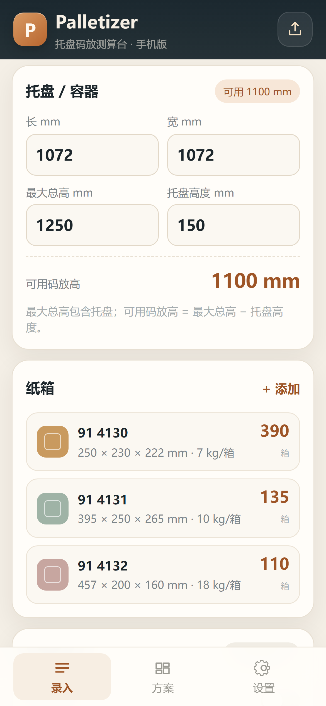
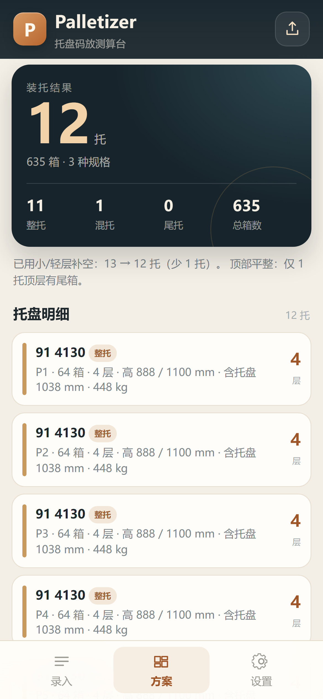
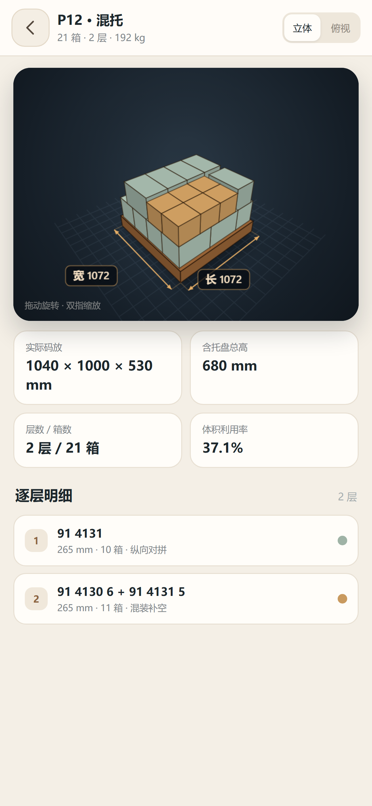
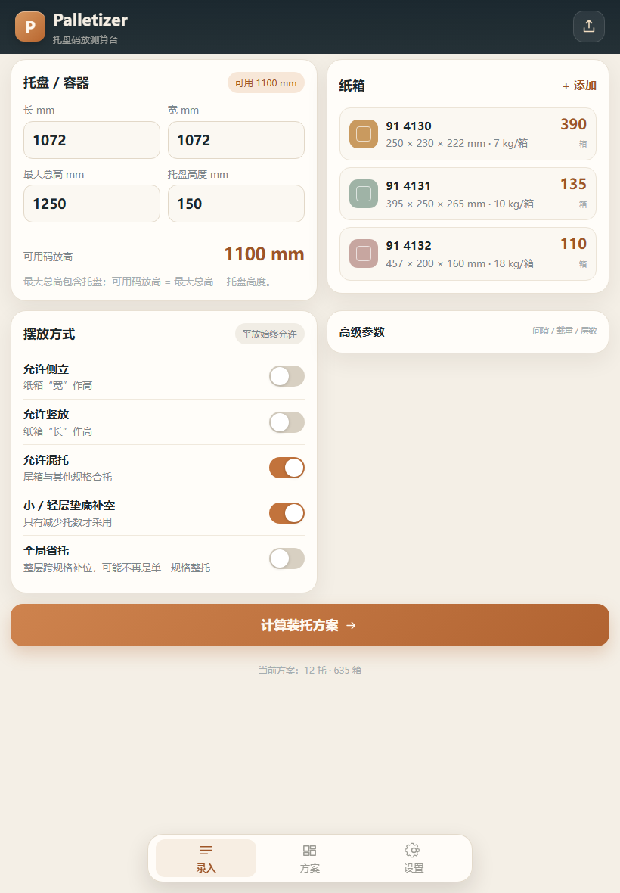
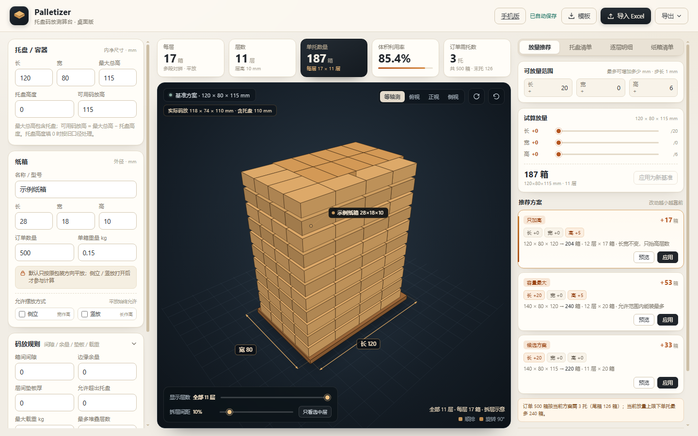

# Palletizer

**托盘码放测算台**  
A responsive pallet loading calculator for iPhone, iPad and desktop.

**v1.9.13：尺寸箭头改为贴近箱边、按箱体比例取字体；水平尺寸文字横排，垂直尺寸文字竖排；去掉重复的尺寸气泡，避免文字重叠。**

> 目标部署地址：<https://taneli888.github.io/palletizer/>  
> GitHub 仓库：<https://github.com/taneli888/palletizer>  
> 部署完成后，用 iPhone Safari 扫码打开，再“添加到主屏幕”。









## 这是什么

Palletizer 是一个纯前端 PWA，针对 iPhone 屏幕重新做了界面：

- 单列大卡片、底部 Tab、底部弹层，适合单手操作；
- **自动适配**：iPhone / iPad 用现在的单列 / 两列手机版；电脑桌面自动进入原版三栏工作台（左录入、中 3D、右方案）；
- 手工添加 / 编辑纸箱；
- 导入 `.xlsx` / `.csv`（托盘参数 + 纸箱明细）；
- 自动计算整托 / 尾托 / 混托 / 全局省托；
- 每一托可以打开 3D 查看，显示实际尺寸和含托盘总高；拖动旋转，**双指捏合缩放**；
- 3D 详情里有 **拆层间距** 滑块，层数多时可以拉开看清每一层；
- 点“逐层明细”里的任意一层，该层会在 3D 中高亮，其他层变暗；
- 设置里有 **字体大小：标准 / 大 / 特大 / 超大**；
- **顶部平整**：不增加托盘数时，尽量把多个“不完整顶层”的尾箱并到一个托盘上，其他托盘恢复整层平顶；
- 导出 / 分享 Excel；
- 安装到 iPhone 主屏幕后可全屏、离线运行。

所有计算都在手机本地完成，不上传订单数据。

## iPhone 上怎么用

### 方式一：直接打开网页

把整个 `Palletizer` 文件夹放到任意 HTTPS 静态托管（GitHub Pages、Netlify、Cloudflare Pages、Vercel 都可以），然后用 Safari 打开。

### 方式二：安装到主屏幕（推荐）

1. 用 **Safari** 打开部署后的网址（不要在微信里直接打开）；
2. 点底部分享按钮；
3. 选择 **“添加到主屏幕”**；
4. 桌面会出现 Palletizer 图标，打开后就是全屏 App。

安装后 Service Worker 会缓存页面，断网也能打开。

### 本地预览

```bash
cd Palletizer
python -m http.server 8765
```

电脑浏览器打开 `http://127.0.0.1:8765/`。  
iPhone 通过局域网 IP 访问时，Service Worker 需要 HTTPS，建议直接用 GitHub Pages / Cloudflare Pages 测试 PWA。

## 部署到 GitHub Pages

1. 新建仓库；
2. 把 `Palletizer` 里的 **index.html、css/、js/、icons/、manifest.webmanifest、sw.js、README.md、docs/** 放到仓库根目录；
3. Settings → Pages → Deploy from a branch；
4. Branch 选 `main`，目录 `/ (root)`；
5. 打开 `https://<用户名>.github.io/<仓库名>/`。

`sw.js` 里的缓存路径是相对的，放在仓库根目录或子目录都能工作。更新后如果仍是旧页面，Safari 里删掉主屏幕图标重新添加，或强制刷新。

电脑浏览器访问根地址时，会自动跳到：

```
https://taneli888.github.io/palletizer/desktop/
```

显示原来的三栏桌面布局；“手机版”按钮或 `?mobile=1` 可强制回到手机布局。

## 兼容性

- iPhone Safari **iOS 16.4+**：Excel `.xlsx` 解压（`DecompressionStream('deflate-raw')`）可用；
- 更老的 iOS：可以手工输入，或把表格另存为 `.csv` 导入；
- 3D 使用 Canvas 2D，不依赖 WebGL；
- 分享 Excel 使用系统分享面板，不支持时会退回下载。

## 和桌面版的区别

- 桌面版是宽屏三栏，手机版是单列 + 底部 Tab；
- 手机版默认示例改成 1072×1072、3 种纸箱，打开即可看到混托 / 3D；
- 核心计算直接复用桌面版的 `core.js`：分层、风车拼花、**多段对拼补空**、同层混装、全局省托、托盘高度都一致；
- **精确优化单层**是单独的 `exact.html` 实验页；默认关闭、不参与日常方案，只有主动打开才加载 OR-Tools WebAssembly；

单层算法会同时比较顺排、旋转、对拼、行列混排、多段对拼、四臂风车和普通风车。比如 1072×1072 托盘放 410×130 纸箱：

- 普通两段对拼是 18 箱/层；
- 多段对拼是 19 箱/层；
- **四臂风车**（四条边各 5 箱，中间留空）是 **20 箱/层**，日常计算直接选它，不需要精确优化。

四臂风车的思路：上下两臂用旋转箱排 5 个，左右两臂用平放箱排 5 个，中间形成一个方形空区。计算时如果风车数不能整除订单量，会尝试略少一箱但能整除的截取层，避免无谓尾层。

## 精确优化单层（实验，默认关闭）

单独打开：

```
https://taneli888.github.io/palletizer/exact.html
```

- 使用 OR-Tools CP-SAT WebAssembly，仅在你主动点击时加载；
- 不参与手机版 / 桌面版的日常计算，离线时不要使用；
- 首次需要联网加载约 8–20MB 求解器资源，手机 Safari 可能不支持；
- 只做单层二维排布，不会自动改整托方案；
- 结果会显示“已证明最优 / 找到更多 / 时限内未证明”，不会把未证明的结果说成最优；
- 支持导入电脑 Python OR-Tools 程序导出的 JSON 坐标（`pallet_w/pallet_h/box_w/box_h/placements`），导入后只做边界/重叠校验，再由你决定是否保存。

网页版 CP-SAT 是单线程的：GitHub Pages 不能设置 COOP/COEP，无法启用多线程共享内存；电脑 Python 版可以开 8 个搜索线程，所以同样时限下更容易找到 20 箱。这是浏览器部署限制，不是模型完全无效。

日常测算仍然使用本地的风车 / 多段对拼启发式，速度不受影响。

### 保存并复用精确布局

- 在精确页点“保存到测算台”；
- 会按 `托盘长宽 + 纸箱长宽 + 间隙` 保存到浏览器本地；
- 回到测算台重新计算时，同尺寸纸箱自动套用；
- 手机设置里可以关闭“自动使用已保存的精确布局”；
- 精确页不内置任何托盘/纸箱结果，必须自己输入并完成本次求解后才会出现“保存到测算台”。

## 命名方案库

手机版：设置 → 方案库；电脑版：右上角“方案”。

- 给当前方案命名后保存；
- 保存内容：托盘长宽高/托盘高、纸箱规格和数量/重量、间隙/余量/垫板/载重/层数、朝向/混托/垫底/全局省托、放量范围、匹配的精确布局规则；
- 调取后自动恢复这些输入并重新计算；
- 同名保存会覆盖更新；
- 只存在当前浏览器，不跨设备同步；
- 删除方案不会删除独立的精确布局规则。
- 手机版没有桌面版的放量推荐曲线，保留了最常用的装托、混托、3D、导入导出。

## 目录

```
Palletizer/
├─ index.html
├─ manifest.webmanifest
├─ sw.js
├─ css/mobile.css
├─ css/readability.css   # 字体档位 / 拆层间距
├─ css/responsive.css    # iPhone / iPad 自适应
├─ desktop/              # 电脑桌面原三栏版（功能与手机版同步）
├─ js/core.js          # 桌面版同一套计算内核
├─ js/xlsx-lite.js
├─ js/render3d.js
├─ js/mobile.js        # 手机版界面与交互
├─ icons/
├─ docs/
├─ tools/mobile-test.js
└─ tools/responsive-test.js
```

## 测试

```bash
node tools/mobile-test.js
node tools/responsive-test.js
```

用 Edge CDP 模拟 390×844 iPhone 视口，检查：

- 默认 12 托 / 635 箱；
- 方案列表、P12 混托详情、2 层 3D；
- 手工添加纸箱；
- 导入 Excel；
- manifest 与 Service Worker 注册。

`responsive-test.js` 另外检查：

- iPhone 390：保持单列；
- iPad 820：录入/方案变两列，底部导航收窄；
- Desktop 1440：自动进入 `/desktop/` 原三栏工作台，三栏布局和最新控件齐全；`?mobile=1` 可强制手机布局。

## 关于“原生 App”

这一版是 **PWA**，不需要 Mac、Xcode 或 App Store 审核，Safari 添加到主屏幕后即可像 App 一样全屏运行。

如果一定要上 App Store，需要 macOS + Xcode + Apple Developer 账号（每年 99 美元），可以把现有页面包进 WKWebView，或重写成 SwiftUI；但计算逻辑和界面大部分可以复用，成本主要在签名、审核和原生壳。
